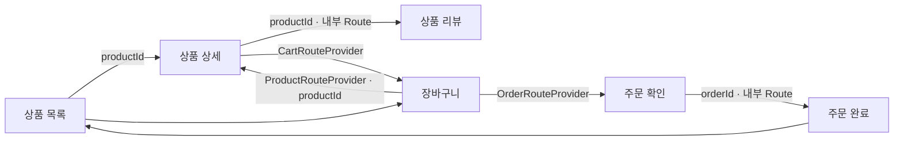
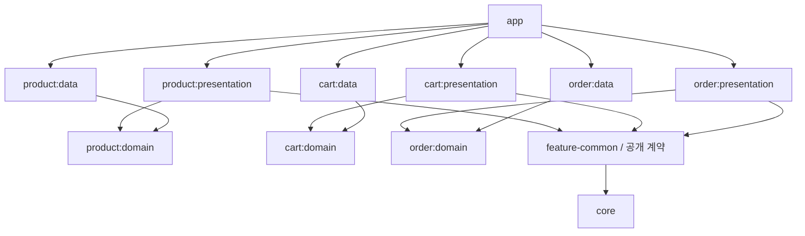
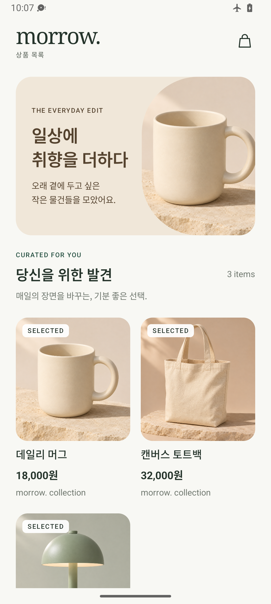
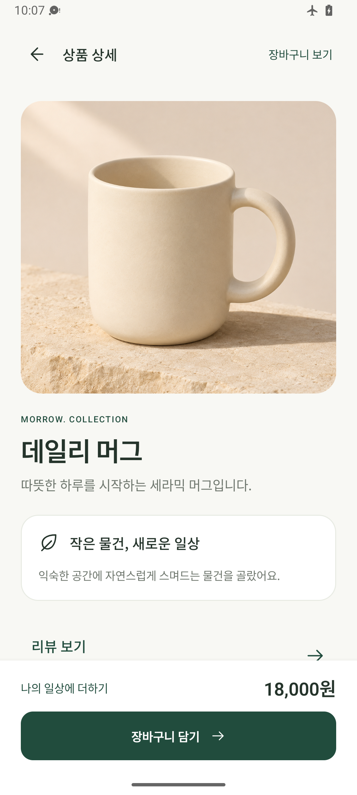
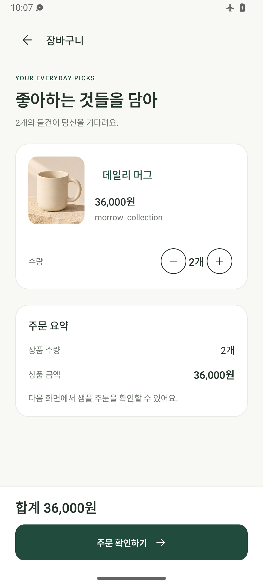
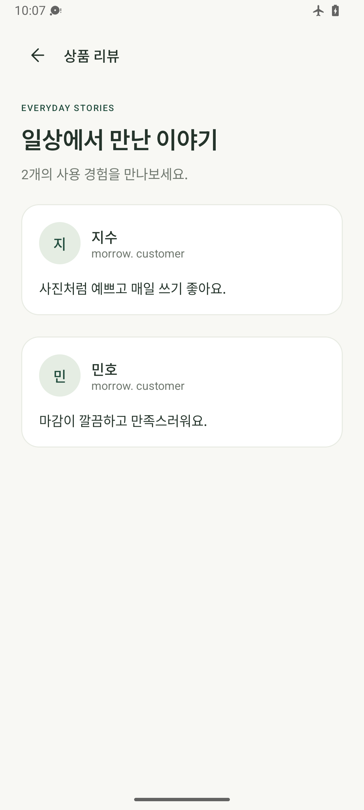
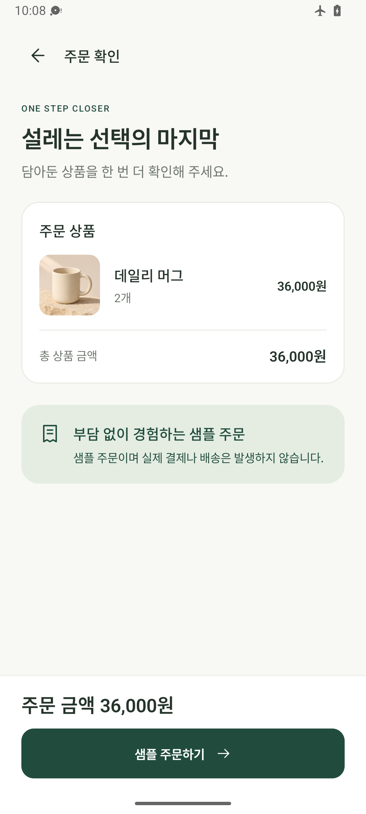
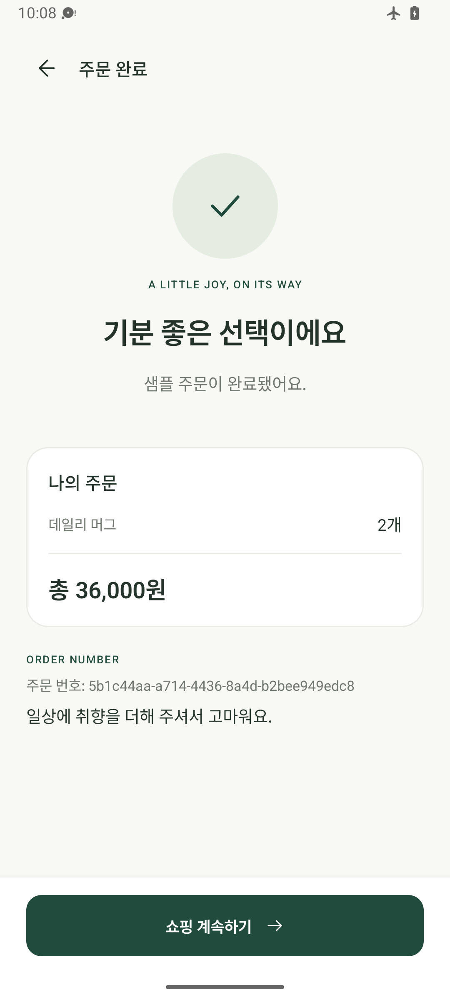

# CommerceNavigationSample

## 네비게이션 구조

```text
feature-common         RouteProvider: 외부에 공개할 경로 생성 계약
core:navigation        NavigationRoute / Navigator: 경로와 이동 명령 계약
                       Navigation3Navigator: Navigation 3 백스택 조작
feature:presentation   Route / EntryPointFactory: 실제 경로와 화면 등록
app                    Hilt Factory 집합 수집 → NavDisplay 조립
```

각 피처는 다른 피처의 화면 구현을 참조하지 않고 공개된 RouteProvider와 Navigator를 통해 이동합니다.

### 화면 등록

```text
ProductNavigationModule의 @IntoSet
    → Set<FeatureEntryPointFactory>
    → NavigationEntryPointRegistry
    → entryProvider에서 Factory.register 호출
    → entry<RouteType>으로 화면 연결
```

하나의 Factory가 같은 피처의 여러 화면을 등록하며, 앱은 피처별 화면 목록을 직접 관리하지 않습니다.

### 인자 전달

```text
장바구니에서 상품 선택
    → productRoutes.productDetailRoute(productId)
    → navigator.navigate(route)
    → Navigation3Navigator가 Route를 백스택에 추가
    → entry<ProductDetailRoute>에서 route.productId 수신
    → ProductDetailScreen(productId)
```

Route는 @Serializable data class로 정의하고 특정 인자 값이 아닌 타입으로 등록합니다.

### 추상화 범위

Navigator와 NavigationRoute 선언은 Navigation 3 타입을 사용하지 않으며, 같은 core:navigation 모듈의 navigation3 패키지에 기본 구현을 둡니다.

Factory의 EntryProviderScope와 실제 Route의 NavKey는 Navigation 3에 의존하므로, 현재 추상화 범위는 이동 명령과 경로 계약입니다.

## 화면 이동



| 경계 | 구현 |
|---|---|
| 피처 내부 이동 | 내부 Route 직접 사용 |
| 피처 간 이동 | 상대 피처의 공개 RouteProvider 사용 |
| 이동 명령 | 피처는 Navigator 인터페이스 사용 |
| 기본 탐색 구현 | core:navigation/navigation3의 Navigation3Navigator가 NavBackStack 조작 |
| 앱의 역할 | 백스택 생성 후 기본 구현을 Factory에 전달 |
| 화면 등록 | 피처별 Factory 하나에서 entry<RouteType> 여러 개 등록 |
| 등록 집합 | Hilt @IntoSet으로 Factory들을 수집 |
| 인자 전달 | Serializable data class에 상품 ID 또는 주문 ID 저장 |
| 화면 상태 | NavEntry별 SaveableStateHolder·ViewModelStore decorator |
| 중복 이동 | 동일한 최상단 Route 추가 방지 |
| 주문 완료 | 시작 화면 위의 이전 경로를 제거한 후 주문 완료 화면 추가 |
| 모듈 의존성 | 다른 피처의 구현 참조 금지, presentation/data → 같은 피처의 domain |

## 주요 코드

- [Navigator 계약](core/navigation/src/main/java/io/github/sangcomz/commercenavigation/core/navigation/Navigator.kt)
- [Navigation 3 기본 구현](core/navigation/src/main/java/io/github/sangcomz/commercenavigation/core/navigation/navigation3/Navigation3Navigator.kt)
- [피처별 화면 등록 계약](core/navigation/src/main/java/io/github/sangcomz/commercenavigation/core/navigation/FeatureEntryPointFactory.kt)
- [상품 피처의 세 화면 등록](feature/product/presentation/src/main/java/io/github/sangcomz/commercenavigation/feature/product/presentation/navigation/ProductEntryPointFactory.kt)
- [외부 공개 상품 경로 계약](feature-common/product/src/main/java/io/github/sangcomz/commercenavigation/feature/common/product/ProductRouteProvider.kt)
- [앱의 NavDisplay 조립](app/src/main/java/io/github/sangcomz/commercenavigation/navigation/AppNavHost.kt)

## 모듈

| 구분 | 모듈 | 역할 |
|---|---|---|
| 앱 조립 | `app` | 시작 경로, Hilt Factory 집합, NavDisplay, Navigator 생성 |
| 공통 계약·탐색 | `core:navigation` | Navigator, NavigationRoute, FeatureEntryPointFactory, Navigation3Navigator |
| 공통 모델·UI | `core:model`, `core:ui` | 상품·장바구니·주문 모델, 테마·레이아웃·상품 이미지 |
| 공개 계약 | `feature-common:{product,cart,order}` | RouteProvider와 CartController |
| 피처별 업무 로직 | `feature:{product,cart,order}:domain` | UseCase와 Repository 계약 |
| 피처별 데이터 | `feature:{product,cart,order}:data` | 메모리 기반 Repository 구현과 DI |
| 피처별 화면 | `feature:{product,cart,order}:presentation` | 화면·ViewModel·Route·Factory·DI |

**업무 피처 3개, 피처 구현 모듈 9개, 공개 계약 모듈 3개, 전체 Gradle 모듈 16개.**



## 화면

| 상품 목록 | 상품 상세 | 장바구니 |
|:---:|:---:|:---:|
|  |  |  |

| 상품 리뷰 | 주문 확인 | 주문 완료 |
|:---:|:---:|:---:|
|  |  |  |

추가 화면: [다크 모드](docs/screenshots/home-dark.png) · [가로 화면](docs/screenshots/home-landscape-dark.png) · [큰 글꼴](docs/screenshots/home-large-text.png)

[이미지 생성 정보](docs/IMAGE_ASSETS.md)
